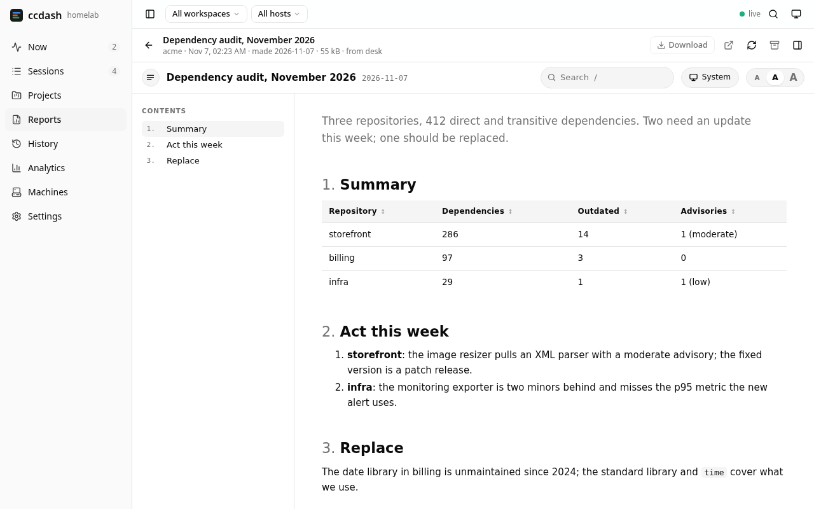

# Reports

Sessions produce page-shaped work: a research write-up, a comparison, an
audit, a dashboard. ccdash keeps those as **reports**: one self-contained
HTML file in a shared design, published to the hub, read in the panel,
searched like any note and downloaded to send on.

1. [What a report is](#1-what-a-report-is)
2. [Making one](#2-making-one)
3. [Publishing](#3-publishing)
4. [Reading, searching, sharing](#4-reading-searching-sharing)
5. [Storage](#5-storage)
6. [Security](#6-security)
7. [Configuration](#7-configuration)

## 1. What a report is

A report is a note of kind `report` ([knowledge](knowledge.md)) with an
HTML file behind it. The note holds the title, a one-line summary and an
**abstract** in markdown (the question, the findings with their numbers,
the recommendation), so `recall`, the session-start context and the
search tell the story without opening the file; `extra` keeps the file's
size, hash, the machine it came from and where it was there. The file is
the whole report: inline styles and scripts, images as `data:` URIs,
nothing fetched from the network, so it reads the same in the panel's
frame, as a file sent to someone, and offline.

Every report wears the same chrome, the `ccdash:report` skill's
`template.html`: a top bar with the title, the date and a search box
(matches marked in the text and listed under the box with their section,
the contents narrowed to the sections that hit, `Enter` and the arrows
step through them, `/` focuses it); a System/Light/Dark switch that
follows the system until picked and, when framed, follows the panel's
mode and wears the panel's colour scheme (Neutral, Catppuccin, the
wallpaper's…); a text size switch, Small/Normal/Big (the whole page
scales; kept on the device, and in the panel the pick carries over to
every report); the contents on the left (a drawer on the phone; the
button beside the title hides the column on a wide screen, for a tall
narrow monitor, and the choice is kept where storage allows), with the
section in view marked; numbered headings; tables that sort by a click on
a heading, with a filter box past eight rows; code blocks with colours,
line numbers and Copy; print styles. On its own the report uses ccdash's
scheme in both modes; charts name the theme's variables so they flip with
it.

## 2. Making one

The `ccdash:report` skill (in the plugin the channel loads) is the
procedure: write the article's body as an HTML fragment, then

```sh
ccdash report build body.html --title "Hair dryer research (Alza.cz)" -o report.html
```

wraps it in the chrome, gives headings ids and refuses a body that fetches
anything (`<script src>`, `<link href>`, an `http` image, `url(http…)`,
`@import`, a frame). `--date` sets the date shown (default: today). The
components the chrome styles (tiles, tables, callouts, badges, figures)
are in the skill's `reference.md`.

## 3. Publishing

The `report_publish` tool, from the session that made the report:

| Argument  | Meaning                                                                                                 |
| --------- | ------------------------------------------------------------------------------------------------------- |
| `path`    | the HTML file on the session's machine (absolute, or relative to the session's directory)               |
| `title`   | default: the file's `<title>`                                                                           |
| `slug`    | default: from the title; publishing to an existing slug replaces that report (the note's version grows) |
| `summary` | one line for lists                                                                                      |
| `body`    | the abstract, markdown; `[[slug]]` links as in any note                                                 |
| `project` | default: the session's project                                                                          |
| `date`    | `YYYY-MM-DD` when it was made, for an older file (default: today); shown as "made …"                    |

The collector reads the file and sends it with the metadata to the hub
(`PUT /reports/-/upload`, this machine's collector token), which checks it
(an HTML document, self-contained, under `reports.max_mb`), keeps the
file, writes the note and answers with the panel's address. Unlike the
other knowledge writes a report is **not queued** while the hub is
unreachable (it is megabytes): the tool says so and the file stays where
it is for another try. A slug that belongs to a note of another kind is
refused.

The session's chat shows a "Published a report" bubble where it happened,
linking to the viewer.

From a shell, the same through the collector:

```sh
ccdash report publish report.html --title "…" --summary "…" --body-file abstract.md [--slug …] [--project …] [--date …]
```

Older reports on a machine come in with

```sh
ccdash report import --dry-run ~/ProjectBundle/tsandrini   # lists: title, date, slug, size; skipped files with the reason
ccdash report import ~/ProjectBundle/tsandrini/.claude-tmp/hair-dryer
```

which walks directories (`node_modules`, `target`, `build` and the like
skipped), takes every HTML document that is self-contained, titles it by
its `<title>`, dates it by the file's modification time, and writes an
abstract naming where it came from and its sections. Edit the note
afterwards in the panel when the abstract should say more.

## 4. Reading, searching, sharing



**Reports** in the sidebar lists every report in the scope, newest first,
by day, with the one note search narrowed to reports (title, summary and
abstract). A report's page frames the document, full height, with its
abstract and facts in a drawer (`▣`), **Download** (the HTML file, to send
on by hand), **Open in a new tab**, **Load again**; a new version
published while the page is open reloads it; **Archive** takes a report
out of the lists (the file stays; "archived too" on the Reports page
shows them, **Restore** brings one back). Each project's page has a
**Reports** tab; the Projects overview counts them; `Ctrl K` finds them
(kind `report`) and opens the viewer; the note itself (the abstract, its
links, the graph) is one click away and has **Open the report**. The
notes export puts a report's `.html` next to its `.md`.

## 5. Storage

The files live under `reports.dir` (`/var/lib/ccdash-hub/reports` with
the NixOS module) as `<workspace>/<slug>.html`, private to the `ccdash`
user, outside the database and its nightly copies: back the directory up
with a file-level tool, like the synced Claude state. A re-publish
replaces the file in one step (written beside it, moved into place once
the note is in). Archiving the note hides the report from the lists; the
file stays. `ccdash export` writes the HTML next to each report's
markdown.

The chrome is baked into every file, so a change to the template reaches
the reports published before it only by rebuilding them, on the hub:

```sh
sudo -u ccdash ccdash report rebuild --config /etc/ccdash/hub.toml --dry-run   # lists: outdated, current, foreign, missing
sudo -u ccdash ccdash report rebuild --config /etc/ccdash/hub.toml [workspace/slug …]
```

takes every report `ccdash report build` made apart, wraps the article in
the current template and writes it back, after copying the file it
replaces to `.archive/<date>/<workspace>/<slug>.html` under the reports
directory (`--archive DIR` elsewhere); the note's size and hash follow,
its version and dates stay (the report did not change, its chrome did).
Imported pages of their own design are left as they are. The hub need
not stop: the files change in place, and the panel loads a report afresh
each time it is opened.

## 6. Security

- `/reports/-/upload` takes a collector's token only.
- The panel never gets the file's address with its token: it asks
  `POST /api/v1/reports/{ws}/{slug}/view` for a **view link**, an HMAC over
  the workspace, the slug and an expiry an hour out, signed with a key
  drawn when the hub starts (a restart ends every link; the panel mints a
  new one when it loads a report). `GET /reports/-/view/<key>` serves the
  file under `Content-Security-Policy: sandbox …; default-src 'none';
script-src 'unsafe-inline'; style-src 'unsafe-inline'; img-src data: blob:
…`: the document is an **opaque origin** whether framed or opened in a
  tab, so a report's scripts never reach the panel's storage or token,
  and nothing loads from the network, which is the self-contained rule
  enforced a second time. The frame adds its own `sandbox` without
  `allow-same-origin`; links out of a report open in a new tab.
- `GET /api/v1/reports/{ws}/{slug}/file` (the download) takes the bearer
  token like the rest of the API.
- Anyone holding a panel token reads every report: keep the hub on the
  LAN or VPN ([security](security.md)).

## 7. Configuration

```nix
services.ccdash-hub.reports = {
  directory = "/var/lib/ccdash-hub/reports";  # default
  maxMb = 32;                                 # also sizes nginx's body limit on /reports/
};
```

```toml
# hub config
[reports]
# dir = "/var/lib/ccdash-hub/reports"   # default: reports/ next to the database
# max_mb = 32
```

Nothing on the collectors: `report_publish` uses the hub link and token
they already have.
